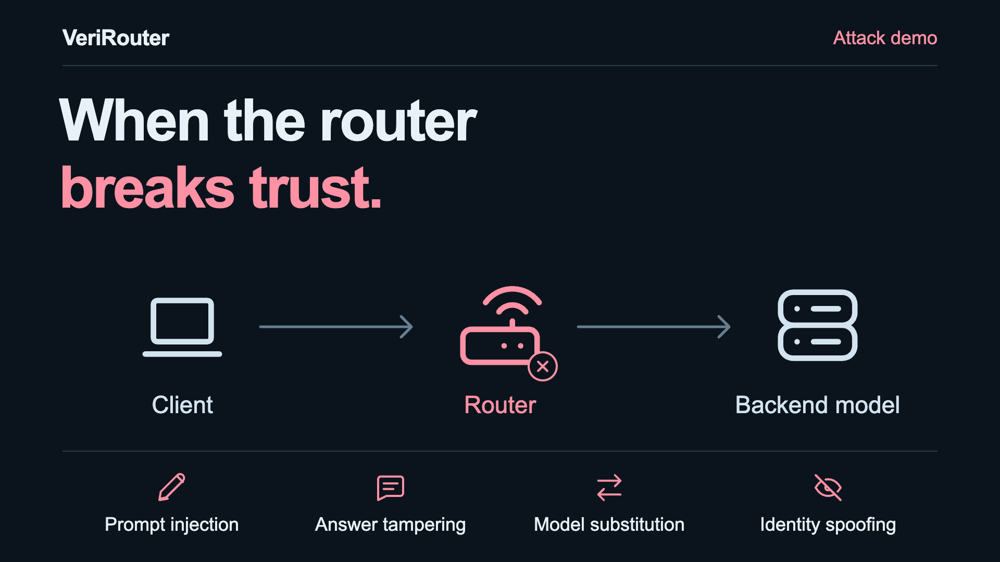

# VeriRouter

**Make OpenRouter more open.**

An LLM router can change your prompt, answer, model choice, and model identity.
VeriRouter makes those hidden steps verifiable while keeping the router's
semantic index and rewrite banks private.

### [→ Try the verifier](https://yao-mengyu.github.io/VeriRouter-website/#interactive)

[Project website](https://yao-mengyu.github.io/VeriRouter-website/) ·
[Paper](https://arxiv.org/abs/2610.17431) ·
[Code](https://github.com/Yao-mengyu/VeriRouter-release)

## Four attacks on one request

Follow a toothache question through the router and see what changes:

- **Hidden instruction injection:** insert unapproved instructions into the forwarded request.
- **Answer tampering:** modify the model's answer before delivering it.
- **Wrong model selection:** serve the request with an ineligible model.
- **Model identity spoofing:** claim that a different model produced the answer.

Watch the [attack demo](https://yao-mengyu.github.io/VeriRouter-website/#attack),
then see VeriRouter detect the same attacks in the
[verification demo](https://yao-mengyu.github.io/VeriRouter-website/#verification).

## Verify a request

1. Open the [interactive demo](https://yao-mengyu.github.io/VeriRouter-website/#interactive)
   and choose **Normal serving** or an attack scenario.
2. Click **Verify** to check the proofs, certificate, and API payload bindings.
   Changing scenarios resets the result and waits for another click.
3. See which checks pass or fail, with measured browser verification times.
   Normal serving passes; the altered serving statements are rejected.

The browser verifies real, offline-generated Plonky2 zero-knowledge proofs
and Ed25519 signatures. It reports both proof times, certificate verification,
and the complete verification time after loading the evidence and WASM.

## How it works

- **Model selection:** a zero-knowledge proof checks the selected model's eligibility.
- **Request rewriting:** a zero-knowledge proof checks that the rewrite is endorsed.
- **Authenticated serving:** a provider-signed certificate binds the backend model,
  processed request, and returned answer.

The proofs keep the router's semantic index and rewrite banks private.
Read the [paper](https://arxiv.org/abs/2610.17431) for the construction and benchmarks,
or explore the [implementation](https://github.com/Yao-mengyu/VeriRouter-release).
